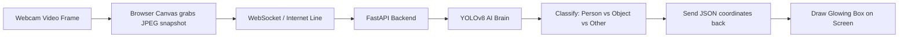

# 📘 The Absolute Beginner's Guide to Real-Time Object Detection

> **Who is this guide for?**  
> If you have never built an AI project before, don't know what a neural network is, or want to explain this project to a friend, client, or teacher in plain English — this guide is for you!

---

## 🌟 1. The Big Picture: What Does This Project Do?

Imagine you are looking out your window. Your eyes capture light, your optic nerve sends the picture to your brain, and your brain instantly says:
* *"That is a human walking a dog."*
* *"That is a parked bicycle."*
* *"That is a coffee cup on the table."*

This project does the **exact same thing**, but using a computer:
1. **The Eye**: Your webcam captures video (images changing 30 times per second).
2. **The Brain**: An artificial intelligence model called **YOLOv8** inspects every frame to locate things.
3. **The Categorizer**: Our code organizes whatever is found into three groups:
   - 👤 **PERSON** (Humans)
   - 📦 **OBJECT** (Everyday items: cell phones, bottles, laptops, chairs, cups, etc.)
   - ⚡ **SOMETHING ELSE** (Animals like cats/dogs, or vehicles like cars/bikes)
4. **The Screen**: Colorful boxes and labels are drawn around each detected item in real time.

---

## 🛠️ 2. The Ingredients: What Technologies Are Used?

Think of this project like a restaurant:

| Tool / Technology | What is it? | Real-World Analogy |
| :--- | :--- | :--- |
| **Python** | The programming language | The language the kitchen staff speaks |
| **YOLOv8 (`yolov8n.pt`)** | The trained Computer Vision model | The master chef who can recognize 80 different objects in a fraction of a millisecond |
| **OpenCV (`cv2`)** | A camera & image processing library | The camera lens and marker pen that grabs video and draws boxes on pictures |
| **FastAPI & Uvicorn** | The backend web server | The waiter who takes camera pictures from the browser, hands them to the chef, and brings back the answers |
| **WebSockets (`/ws/live`)** | A two-way open internet line | A direct telephone/walkie-talkie line that streams frames continuously without hanging up |
| **HTML5 & CSS3** | The frontend website structure & styling | The sleek restaurant dining room and dashboard with neon glowing indicators |
| **JavaScript Canvas** | The frontend graphics engine | The transparent glass sheet placed over the video where bounding boxes are drawn |

---

## 🔄 3. How a Single Video Frame Travels (Step-by-Step)

Here is what happens behind the scenes **20 to 30 times every single second**:



1. **Capture**: The webcam grabs one frame (an array of colored pixels).
2. **Compress**: The browser converts that picture into a compact string of text (called Base64 JPEG).
3. **Send**: The browser transmits that picture to our Python backend server.
4. **Inspect**: The YOLOv8 model runs math across all pixels and finds shapes that match trained objects.
5. **Output**: The model outputs numbers: 
   - Where the box is: `x1, y1, x2, y2`
   - What it is: `"cell phone"`
   - How sure it is: `88%`
6. **Classify**: Our logic converts `"cell phone"` into `[OBJECT: Cell Phone]` and gives it an Amber color (`#f59e0b`).
7. **Draw**: The screen updates immediately, placing the box right around the phone.

---

## 🔍 4. Code Breakdown: What Does Each File & Segment Do?

Our project has two main ways to run:
- **`app.py`**: The Web Server (for browser dashboard)
- **`live_cam.py`**: The Standalone Desktop Camera (native window)

Let's dissect both line-by-line in plain English!

---

### 📂 File 1: `app.py` (The Backend Server)

#### Segment 1: Loading the AI Model
```python
# app.py (Lines 44-47)
model = YOLO(str(WEIGHTS_PATH))
class_names = model.names
```
* **What it does**: Loads the trained neural network brain (`yolov8n.pt`) into your computer's memory.
* **Why it matters**: `yolov8n.pt` is a file holding millions of mathematical numbers (weights) that took thousands of computers days to learn from millions of photos. We load it once when the server starts.

---

#### Segment 2: The 3-Way Categorization Engine
```python
# app.py (Lines 49-92)
COCO_PERSON = {"person"}
COCO_ANIMALS = {"bird", "cat", "dog", "horse", ...}
COCO_VEHICLES = {"bicycle", "car", "motorcycle", ...}

def classify_coco_item(class_name: str):
    if name_lower in COCO_PERSON:
        return {"category": "person", "color": "#10b981", ...}
    elif name_lower in COCO_ANIMALS or name_lower in COCO_VEHICLES:
        return {"category": "something_else", "color": "#d946ef", ...}
    else:
        return {"category": "object", "color": "#f59e0b", ...}
```
* **What it does**: Out of the box, YOLO knows 80 specific items (e.g. `dog`, `bottle`, `chair`, `person`).
* **Why it matters**: This segment groups those 80 specific labels into your desired **3 main buckets**:
  1. `person` ➡️ **PERSON** (Green)
  2. Inanimate items (phones, bottles, laptops) ➡️ **OBJECT** (Amber Gold)
  3. Animals & Vehicles ➡️ **SOMETHING ELSE** (Magenta / Cyan)

---

#### Segment 3: The Inference Engine (`run_yolo_inference`)
```python
# app.py (Lines 114-170)
def run_yolo_inference(img_bgr, conf_thresh, iou_thresh):
    results = model.predict(source=img_bgr, conf=conf_thresh, iou=iou_thresh)
    ...
```
* **What it does**: This is the heart of the system. It takes an image, asks the model *"What do you see?"*, and packages the results.
* **Key settings**:
  - `conf_thresh` (Confidence Threshold): If the AI is only 20% sure something is a dog, should it tell you? A threshold of `0.25` means *"Only show things you are at least 25% sure about."*
  - `iou_thresh` (Overlap Filter): Prevents drawing 5 overlapping boxes over the same person.

---

#### Segment 4: The Live WebSocket Roadway (`/ws/live`)
```python
# app.py (Lines 267-299)
@app.websocket("/ws/live")
async def websocket_live_detection(websocket: WebSocket):
    await websocket.accept()
    while True:
        data = await websocket.receive_json()
        # Decode image from browser -> run inference -> send back answers
```
* **What it does**: Keeps an open connection with the browser. Instead of reloading the page or creating a new connection every frame, it acts like a live pipe that continuously sends pictures and receives coordinates.

---

### 📂 File 2: `live_cam.py` (Standalone Desktop Window)

If you don't want a web browser and just want a fast, direct desktop window:

#### Segment 1: Opening the Webcam Hardware
```python
# live_cam.py (Lines 140-155)
cap = cv2.VideoCapture(0)
```
* **What it does**: Asks your operating system for camera #0 (your default webcam). `cap.read()` grabs one live frame.

#### Segment 2: The Continuous Game Loop
```python
# live_cam.py (Lines 167-240)
while True:
    ret, frame = cap.read()
    results = model.predict(source=frame, conf=conf_thresh)
    # Loop over every detected box and draw corners
```
* **What it does**: An infinite loop that:
  1. Reads the current frame from your camera lens.
  2. Runs YOLO to locate items.
  3. Draws stylish brackets around them.
  4. Displays the frame on your screen via `cv2.imshow()`.
  5. Repeats forever until you press `Q`.

#### Segment 3: Interactive Hotkeys
```python
# live_cam.py (Lines 232-245)
key = cv2.waitKey(1) & 0xFF
if key == ord('q'): break        # Quit
elif key == ord('s'): ...        # Save snapshot image
elif key == ord('+'): ...        # Make sensitivity higher/lower
```
* **What it does**: Listens to your keyboard while the window is focused.

---

### 📂 File 3: The Frontend (`index.html` & `app.js`)

#### 1. The Video & Canvas Stack (`static/index.html`)
```html
<div class="webcam-media-container">
  <video id="webcam-video" autoplay playsinline muted></video>
  <canvas id="webcam-canvas" class="webcam-overlay-canvas"></canvas>
</div>
```
* **The trick**: Notice that there are two layers on top of each other:
  - **Layer 1 (Bottom)**: `<video>` shows your real camera feed.
  - **Layer 2 (Top)**: `<canvas>` is a transparent glass layer sitting directly on top of the video where JavaScript draws boxes.

#### 2. Grabbing Frames Without Lag (`static/js/app.js`)
```javascript
// captureAndSendFrameWS()
if (isFrameInFlight) return; // Drop frame if backend is still thinking!
```
* **Why this is critical**: If your computer takes 100 milliseconds to process a frame, but the camera takes 30 frames a second, frames will pile up and create a 10-second delay!
* **The fix**: We use `isFrameInFlight`. If the server is currently busy with a frame, we simply wait until it is done before sending the next one. This guarantees **zero latency**!

#### 3. Mirrored Display Correction
* When you look at a webcam, you expect it to act like a **mirror** (if you raise your right hand, the hand on the right side of the screen moves).
* Because the video is mirrored with CSS `scaleX(-1)`, our code flips the horizontal X coordinates (`mx1 = width - box.x2`), ensuring the box sits on your hand, but keeps the text readable from left to right!

---

## 🧠 5. Plain-English Glossary of AI Terms

| Term | What it actually means |
| :--- | :--- |
| **Bounding Box** | A rectangle defined by 4 numbers: top-left corner `(x1, y1)` and bottom-right corner `(x2, y2)`. |
| **Confidence Score** | A percentage (e.g. `0.91` = `91%`) telling how sure the AI is about its guess. |
| **COCO Dataset** | "Common Objects in Context" — a famous library of hundreds of thousands of labeled images used worldwide to train AI models. |
| **Inference** | The act of running a picture through an already-trained model to get predictions (as opposed to "training" which creates the model). |
| **FPS (Frames Per Second)** | How many pictures are processed every second. 30 FPS looks completely smooth to the human eye. |
| **Latency (ms)** | How many milliseconds (1/1000th of a second) it takes between grabbing a camera frame and showing the box. ~50ms feels instantaneous. |

---

## 🚀 6. Quick Cheat-Sheet: How to Run Everything

### Method A: Standalone Desktop Window (Fastest & Simplest)
```bash
python live_cam.py
```
- Opens a dedicated camera window immediately.
- Press <kbd>Q</kbd> to quit, <kbd>S</kbd> to save a photo.

### Method B: Modern Web Dashboard
```bash
python app.py
```
- Open browser at: **[http://127.0.0.1:8000](http://127.0.0.1:8000)**
- Click **"Live Webcam"** ➡️ **"Launch Webcam Detection"**.
- Features live Classification Matrix badges, class filters, and JSON export!
